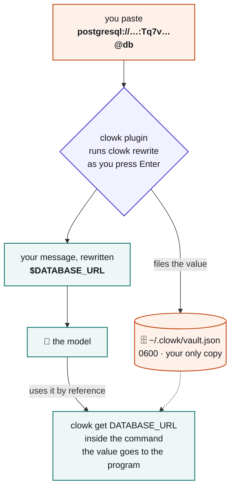
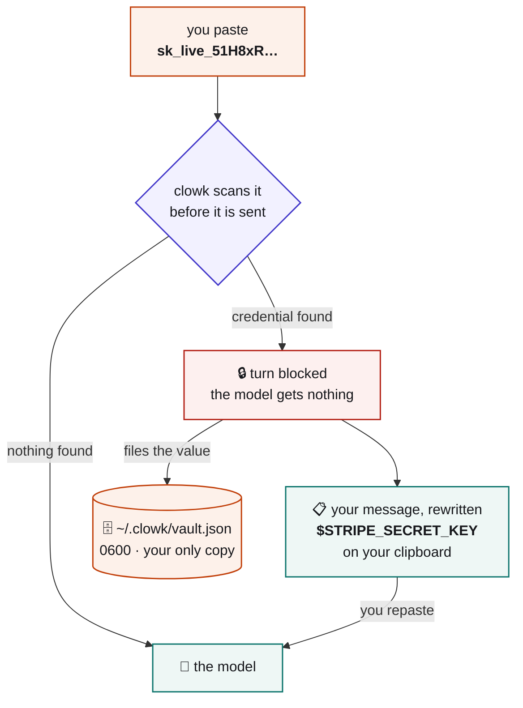
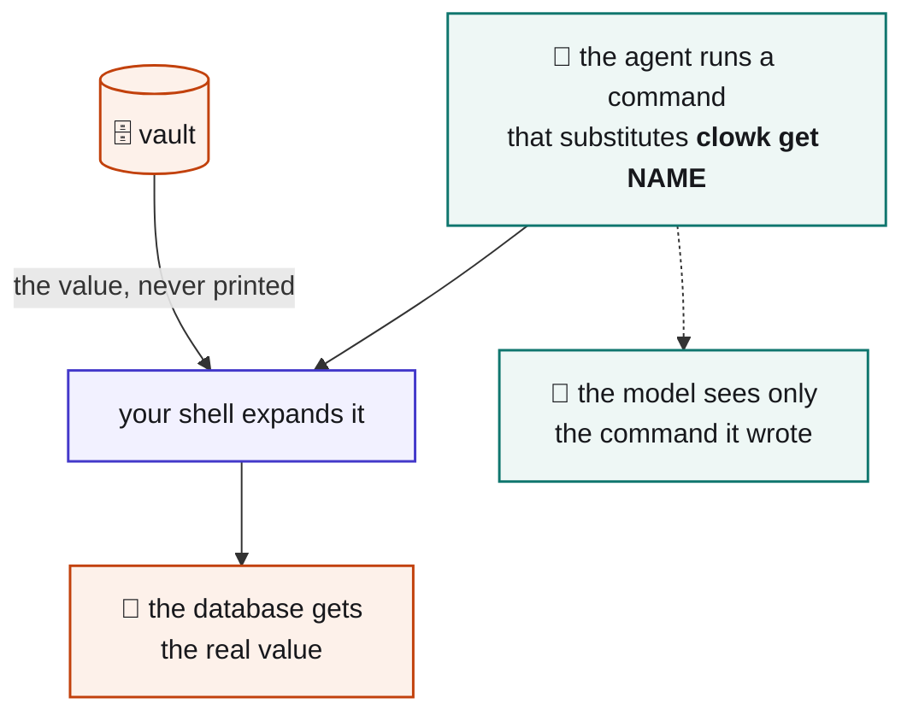
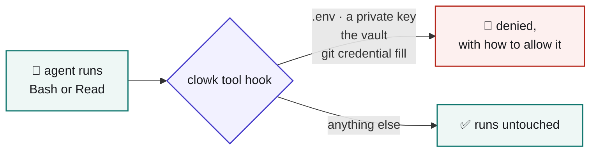

<div align="center">

<picture>
  <source media="(prefers-color-scheme: dark)" srcset="https://raw.githubusercontent.com/Aniumbott/clowk/main/assets/logo-dark.svg">
  
</picture>

# clowk

**Catches credentials you paste into Claude Code and swaps them for a name before the model sees them.**

[](https://github.com/Aniumbott/clowk/actions/workflows/ci.yml)
[](https://www.python.org/downloads/)
[](https://github.com/Aniumbott/clowk/blob/main/LICENSE)

</div>

Paste a database URL, an API key or a token into Claude Code and press Enter. clowk swaps the value
for a `$NAME` before the message is sent, files the value in a local vault, and lets the message go on.
The model only ever gets the name, and your agent uses the credential by reference:
`psql "$(clowk get DATABASE_URL)"`. You don't repaste anything and nothing is blocked.

```
❯ check this connects and tell me how many orders we have: $DATABASE_URL
  🔒 clowk  $DATABASE_URL stayed on this machine · the model gets the name, never the value
⏺ Bash(psql "$(clowk get DATABASE_URL)" -Atc "select count(*) from orders;")
  ⎿  1284
⏺ The production database connected, and it has 1,284 orders.
```

Claude Code 2.1.287+, through a Claude Code plugin. Python 3.8+, standard library only. No daemon,
nothing to sign up for, and **nothing in the guard touches the network**.

Codex and Gemini CLI are supported in [classic mode](#classic-mode-codex-gemini-cli-and-older-claude-code):
their hooks can only block a prompt, not rewrite it, so the turn is blocked and your message comes
back on your clipboard with the `$NAME` in it.

**Why it exists:** [113 of my Claude Code transcripts had an API key in them](https://aniumbott.medium.com/113-of-my-claude-code-transcripts-had-an-api-key-in-them-and-clowk-helped-me-stop-that-70cababb21a1)
— what I found when I went looking through my own, and what clowk was built to stop.

## Contents

| | |
|---|---|
| [Quick start](#quick-start) | Install in two commands |
| [In Claude Code](#in-claude-code) | What the plugin does, and how it fails |
| [Classic mode](#classic-mode-codex-gemini-cli-and-older-claude-code) | Codex, Gemini CLI, and Claude Code before 2.1.287 |
| [What it is good for](#what-it-is-good-for) | Beyond catching a mistake |
| [Uninstalling](#uninstalling) · [Updating](#updating) | The vault decision, and keeping the skill current |
| [How it works](#how-it-works) | The capture path and what gets detected |
| [Using a credential](#using-a-credential) | `$(clowk get NAME)` and the guard around it |
| [Commands](#commands) | The full CLI |
| [The tool-deny hook](#the-tool-deny-hook) | For leaks you did not type |
| [Architecture](#architecture) | Everything on one diagram |
| [Limitations](#limitations) | What this does not protect you from |
| [Configuration](#configuration) | Paths and environment variables |
| [False positives](#false-positives) | Why they happen and how to clear them |
| [Contributing](#contributing) | How to help |
| [Security](#security) | Reporting a vulnerability |
| [Development](#development) | Tests, layout, the ruleset |

## Quick start

```bash
uv tool install clowk        # or: pipx install clowk
clowk setup
```

That's it. `clowk setup`:

1. finds the agent CLIs on your machine and registers clowk's hooks in each,
2. installs the skill that tells the agent what a `$NAME` is,
3. on Claude Code 2.1.287+, installs the clowk plugin through `claude plugin`,
4. fires a test credential through the hook it just registered, to prove the guard really blocks.

Restart Claude Code afterwards so it loads the plugin.

> **`pip install clowk` will not work on most machines**, and that is not clowk's doing: Homebrew,
> Debian, Ubuntu and Fedora Pythons refuse to install into themselves
> ([PEP 668](https://peps.python.org/pep-0668/)). No uv or pipx? A clone needs no installer at all:
> `git clone https://github.com/Aniumbott/clowk.git && cd clowk && python3 clowk/cli.py setup`.

For dotfiles, a Dockerfile or CI, it runs unattended:

```bash
clowk setup --hosts claude-code --yes
clowk setup --dry-run                     # print the plan, write nothing
```

To add the plugin by hand instead, in Claude Code:

```text
/plugin marketplace add Aniumbott/clowk
/plugin install clowk@clowk
```

<details>
<summary>Install details: PATH, aliases, what setup writes</summary>

A package install already provides `clowk` on your PATH through an entry point, so nothing extra is
written. From a clone there is no entry point, so `install` writes `~/.local/bin/clowk` — and if that
directory is not on your `PATH` it says so and prints the line to add. Either way `clowk` has to be a
real command, because the callers that matter are the plugin and the non-interactive shell your agent
runs.

> **Do not substitute a shell alias.** Aliases exist only in interactive shells, and the caller that
> matters is the non-interactive Bash your agent runs. There `$(clowk get NAME)` expands to nothing,
> your command runs *without* the credential, and the error looks like a bad key rather than a
> missing tool.

`install` merges into your existing settings, backs them up first, and refuses a settings file that
is not valid UTF-8 JSON. `uninstall` removes only what clowk wrote, byte for byte. Hooks and launcher
hold absolute paths to this clone and to the interpreter you ran `install` with, so nothing depends on
`PATH` — but move the clone and you re-run `install`.

</details>

## In Claude Code

The clowk plugin is a Claude Code mod: code that runs inside Claude Code and can change a prompt on
its way out, which a settings hook cannot do. On each prompt it runs `clowk rewrite` (about 85 ms),
so the `clowk` package has to be installed and on your `PATH`.

| What happens | Detail |
|---|---|
| **You paste a credential** | It becomes its `$NAME` as you press Enter and the message goes on. Your message shows the name in teal, with a note under it that the value stayed on this machine. |
| **The agent needs it** | It runs `psql "$(clowk get DATABASE_URL)"`. The value goes to the program, not the model. The model is told what a `$NAME` is through context it reads but you never see. |
| **A command prints one** | What a command prints is scrubbed too: a credential in the output of `Bash`, `Grep`, `WebFetch`, `WebSearch` or an MCP tool reaches the model as its `$NAME`. Output is held to vendor formats and connection URLs. The two generic shape rules are skipped there, because in output they mostly match hashes and ids. |
| **The agent goes looking** | The [tool-deny hook](#the-tool-deny-hook) refuses `cat .env`, private keys, `git credential fill` and the vault itself. |
| **A subagent reports back** | Turns Claude Code starts by itself, like a subagent's report or a background task's notice, are not checked. What is in them came from a model or a tool, and blocking them cut agents off mid-task. |

`Read` output is left alone on purpose. An agent edits what it reads, and a file written back with
`$NAME` in place of the value would lose the value. `cat file` followed by a whole-file write has the
same risk; it is rare.

**It fails closed.** If `clowk` can't run (missing, an error, a timeout), the message is not sent,
and the reason on screen says why. Starting a message with `unclowk` sends it unchecked.

- **A `clowk` older than the plugin:** the plugin steps aside, the package's own hooks block as
  before, and a status line under the prompt says to run `clowk update`.
- **The plugin not running at all** (`--bare`, `--safe-mode`, a policy that refuses user mods): the
  hooks `clowk setup` registered are the backstop. They run beneath the plugin, see only the
  rewritten text, and pass it. With the plugin off, they block, as in classic mode.

## Classic mode: Codex, Gemini CLI, and older Claude Code

Agent CLIs whose hooks can only allow or block a prompt get the original flow. So do Claude Code
before 2.1.287 and Claude Code without the plugin. The turn is blocked before anything is sent, the
value is filed, and your message comes back **on your clipboard** with the `$NAME` in it, ready to
repaste:

```
👀 clowk caught a credential before it reached the model.

   💾  $STRIPE_SECRET_KEY

📋 Paste this — already on your clipboard:

   rotate this key for me: $STRIPE_SECRET_KEY

🤔 Not a credential? Resend starting with  unclowk
```

The message shows only the lines the credential was on, cut to 40 characters either side, with the
name highlighted where the terminal can show it. `$(clowk get NAME)`, the tool-deny hook and the vault
work the same as in Claude Code.

| Host | Status |
|---|---|
| Claude Code 2.1.287+ | full: the plugin rewrites in place |
| Claude Code before 2.1.287, or without the plugin | classic, verified |
| Codex | classic, verified. Hooks need trust: run `/hooks` and approve clowk; trust is hash-based, so every update asks again |
| Gemini CLI | classic; the hooks are registered, but its payload shape is **not verified** (`clowk debug-payload` shows what it sends) |
| Antigravity, opencode, Grok CLI | not supported yet |

## What it is good for

Catching a paste is how most people meet clowk, but it is the smaller half. The same three
primitives — a local store, a `$NAME` reference that is worthless on its own, and a guard that only
permits command substitution — make clowk a **credential supply route for agents** rather than only a
net under your mistakes.

Nothing here needs a credential to have been leaked first. `clowk add NAME` takes a value at the
terminal, so it never enters a chat at all.

| Use it for | How |
|---|---|
| **Credentials that survive across sessions** | `clowk add` each one once, then name clowk in your `CLAUDE.md`. Every future session can reach `$(clowk get DATABASE_URL)` without a value ever entering a prompt, a transcript, or the model. |
| **Keeping keys out of the agent's environment** | A captured value is not exported. `env`, `printenv` and a leaked `.env` dump cannot reveal it — unlike `export STRIPE_KEY=…` in your shell profile, which every agent session inherits and any `env` call prints straight into the transcript. |
| **Runbooks and docs you can commit** | `psql "$(clowk get DATABASE_URL)"` is safe to write into a committed runbook, `CLAUDE.md`, or a README. The reference is worth nothing to whoever clones it. |
| **One store across several agent CLIs** | Claude Code, Codex and Gemini CLI all read the same `~/.clowk/vault.json`. One credential store instead of three sets of environment variables. |
| **Rotation without archaeology** | `clowk uses NAME` reports where a credential was captured and every directory that has drawn on it since, so a rotation is a list to work through rather than a guess. |
| **Noticing a bad habit** | Re-catches are counted. When `clowk list` says a key has been caught five times, that key belongs in `clowk add` and out of your muscle memory. |
| **Agent-initiated leaks** | The tool-deny hook refuses `cat .env`, `git credential fill`, private keys and the vault itself — the ways a credential reaches a transcript without you typing anything. |
| **Pasting logs and dumps** | Credentials inside a pasted log are redacted before the model sees them, whether or not they get filed. |

**What it is not good for.** Screen sharing and recordings: what you paste is on screen until you
press Enter — and for a moment after, while Claude Code draws the message before the plugin's
rewrite lands. In classic mode Claude Code prints the raw prompt back under clowk's message. The model
never gets the value either way, but the screen does.
It is also not a CI or deployment secret manager — there is no daemon, nothing on the network in the
capture path, and the vault is a local file belonging to one user.

## Uninstalling

```bash
clowk uninstall                       # per host you registered
```

**Your credentials are a separate decision, and `uninstall` makes you take it.** The vault is the only
copy of every value in it, so removing clowk does not remove `~/.clowk/vault.json` unless you say so.
Either way it tells you the file is still there, how many credentials it holds, and that nothing else
on your machine reads it — a plaintext file of live keys should not be left behind by accident, and it
should not be destroyed by accident either.

Interactively you get three options: back it up first, delete it, or keep it. Deleting asks you to
type `DELETE` rather than pressing a key, because it cannot be undone. Unattended, it keeps the vault
and prints the flags:

```bash
clowk uninstall --backup ~/clowk-backup.json   # the vault itself, values and all, mode 0600
clowk uninstall --purge                        # delete the vault, no prompt
clowk uninstall --keep-vault                   # keep it without being asked
```

The backup is the vault's own JSON rather than a report, so **restoring is a file copy** —
`cp ~/clowk-backup.json ~/.clowk/vault.json` — not a re-typing of every credential. It carries a
`_restore` key saying so, since JSON cannot hold a comment.

It is plaintext by definition, and **clowk's own deny hook does not protect it** — that hook knows the
vault's real path and nothing else. Move it somewhere safe or delete it once you are done.

> **Run `clowk uninstall` before `pip uninstall clowk` or `pipx uninstall clowk`.** Removing the
> package first leaves the hooks registered, pointing at a script that no longer exists — and since
> every host fails open, that is a guard that silently passes every credential from then on.

On Windows use `python` or `py`; there is no `python3` on a stock install. On Codex, hooks need
trust: run `/hooks` and approve clowk. Trust is hash-based, so every update asks again.

## Updating

```bash
clowk update           # --check to look without changing anything
```

**Why this is a command and not just `git pull`.** The hooks and launcher hold absolute paths, so they
pick up new code immediately — but the skill is *copied* into each host's skills directory and
`/clowk` is *generated* into `~/.claude/commands/`, so neither moves until install runs again. New
code, old skill, and nothing on screen saying so. `clowk update` does both halves for every host you
have registered.

For a clone it runs `git pull --ff-only` itself, refusing if you have modified tracked files.
Untracked files are ignored, since they cannot make the pull fail. For a package install it prints
the right command for the manager it can see — `pipx upgrade`, `uv tool upgrade` or `pip install
--upgrade` — rather than guessing, because guessing wrong can leave a half-replaced package and on
Windows `pip install -U` against a running package can fail on locked files.

**The plugin updates through Claude Code, not through `clowk update`.** Claude Code caches it
under `~/.claude/plugins/cache/clowk/clowk/<version>/`, keyed by `plugin.json`'s version. A release
bumps that version; then `/plugin marketplace update clowk` and `/reload-plugins` pick it up. Until
then the cached copy keeps running, and if it is older than the package it still works: the package
is what it calls.

<details>
<summary><code>/clowk</code> and the skill</summary>

`clowk install` writes `~/.claude/commands/clowk.md`, so `/clowk` works with no further steps, and
copies the skill to `~/.claude/skills/clowk/` so the agent knows what a `$NAME` is. Without that
skill an agent reads `$DATABASE_URL` as an ordinary empty variable and asks you to paste the real one
again. The plugin carries the same skill and `/clowk:clowk`; both copies read the same vault.

</details>

## How it works

In Claude Code, the plugin rewrites the prompt on its way out:



In classic mode, a hook can only allow or block, so it blocks and hands the rewrite back on your
clipboard:



**Why two shapes?** No settings hook can rewrite a prompt you have already submitted — verified on
Claude Code, Codex and Gemini CLI. A hook may block or allow, and that is the entire API. Claude Code
2.1.287 added mods, which can rewrite, so on Claude Code the plugin does. Everywhere else
block-and-repaste is the only shape there is, and the clipboard is what keeps it tolerable.

### Detection

221 [gitleaks](https://github.com/gitleaks/gitleaks) rules plus three of clowk's own: one for
credential-shaped tokens standing alone, and one for each connection-string dialect.

- **Connection strings are captured whole.** `postgresql://user:pw@host/db` files as
  `$DATABASE_URL`, so your hostname and database name do not travel either. The `key=value;` dialect
  used by Microsoft SDKs and ODBC drivers gets the same treatment — an Azure storage string files as
  `$AZURE_STORAGE_CONNECTION_STRING` rather than having its `AccountKey` swapped while
  `AccountName=prodstore` rides along.
- **Placeholders are left alone.** `changeme`, `<your-account-key>`, and values that are already
  references such as `$DB_PASS`.
- **At most 20 names per message.** More hits than that is a pasted log, not a paste of credentials.
  The rest are still redacted and the turn is still blocked; they are just not filed.

### Naming

The `$NAME` comes from whatever identified the credential:

| Case | Name |
|---|---|
| A vendor rule matched | its own name — `$STRIPE_SECRET_KEY` |
| Caught only because of a label you typed | that label — `secret access key = …` → `$SECRET_ACCESS_KEY` |
| No label anywhere near it | `$SECRET` |
| Name taken, same value | reused; the directory is added to the ledger |
| Name taken, different value | suffixed — `$NAME_2`; nothing is overwritten |

## Using a credential

A captured value is **not** in your agent's environment — `echo $DATABASE_URL` prints nothing, by
design. Substitute it at the point of use:

```bash
psql "$(clowk get DATABASE_URL)"
curl -H "Authorization: Bearer $(clowk get STRIPE_SECRET_KEY)" https://api.stripe.com/v1/charges
```



The shell hands the value to the command as an argument. Nothing wraps your command, so your host's
own permission rules still match what you actually ran.

**`clowk get` is the only thing that prints a credential, so it is guarded.** A second hook refuses a
bare `clowk get`, a substitution piped into `echo`/`cat`/`printf`, a redirect, and capture into a
shell variable — each of those would put the value back in your transcript. The check lives in the
hook rather than in `clowk get` because a process cannot tell whether it was command-substituted.

Your agent learns this from a skill `setup` installs, pointed at from a session's first block so the
rule arrives with the `$NAME` it governs. What each host gets:

| Host | Hooks | Skill | `/clowk` |
|---|---|---|---|
| Claude Code | `UserPromptSubmit` + `PreToolUse` | `~/.claude/skills/clowk/` | yes |
| Codex | `UserPromptSubmit` + `PreToolUse` | `~/.codex/skills/clowk/` | no |
| Gemini CLI | `BeforeAgent` + `BeforeTool` | none — it has no skills directory, so setup says so rather than inventing a path | no |

Every `clowk get` is recorded, so `clowk uses` tells you where a credential was caught and what has
drawn on it since. Re-catches are counted too: `clowk list` will tell you a key has been caught five
times and when the last one was. That number is worth watching — pasting the same credential
repeatedly is a habit, and `clowk add` is how you stop.

## Commands

| Command | Description |
|---|---|
| `clowk list` | Stored credentials — names and metadata, never values |
| `clowk add NAME` | Type a credential at the terminal instead of pasting it in chat |
| `clowk get NAME` | Print one, for command substitution only |
| `clowk set NAME` | Replace a value after rotating it upstream |
| `clowk clear NAME` | Forget one |
| `clowk rename OLD NEW` | Rename one |
| `clowk uses [NAME]` | Where a credential was caught, and what has drawn on it |
| `clowk allow PATTERN` | Stop denying one of clowk's rules — a filename, suffix or command phrase, exactly as the deny message prints it |
| `clowk deny PATTERN` | Undo an allow |
| `clowk update` | Fetch new code, then refresh the skill and command that do not move on their own. `--check` looks without changing |
| `clowk setup` | Guided first-time setup: detect hosts, install, then verify the guard actually blocks. `--hosts a,b`, `--yes`, `--dry-run` for unattended use |
| `clowk install [HOST]` | Register hooks for one host |
| `clowk uninstall [HOST]` | Remove them, then decide about the vault. `--backup FILE`, `--purge`, `--keep-vault` |
| `clowk --version` | The installed version |
| `clowk debug-payload` | Dump what a host sends, for adding a new one |
| `clowk rewrite` | What the Claude Code plugin runs on each prompt: reads `{"prompt": …}` on stdin, files what it finds, prints the rewritten text as JSON |

`add` and `set` never take the value as an argument — that would put it straight in your shell
history.

> **After a rotation, use `set`.** Paste a replacement for a credential clowk already holds and
> nothing is overwritten: the new value files as `$NAME_2` while `$NAME` still resolves to the
> revoked one. The block message says so and prints the `clowk set NAME` that moves the name across,
> keeping when and where it was first caught. clowk will not move it for you — an existing `$NAME`
> quietly changing meaning is the same accident in the other direction.

## The tool-deny hook

Your agent can leak a credential without you touching the keyboard: it `cat`s a `.env`, or runs
`git credential fill`, and the value is in the transcript. A second hook denies the easy ones.



It denies *running* those, not mentioning them — a path in a commit message, an `echo`, or a grep
pattern all pass. A path counts as a read only when something that reads files is running it.

## Architecture

Everything at once, including the parts with no flow to draw. Click through for full size.

[](https://github.com/Aniumbott/clowk/blob/main/assets/architecture.svg)

## Limitations

**clowk is not a security boundary.** It runs as the same OS user as your agent, so whatever clowk
can read, `cat` can read. It stops accidents; it will not stop an agent that is genuinely trying. A
real boundary needs a separate OS user, a container with clowk outside it, or a code-signed binary
holding an OS keychain ACL.

| Limitation | Detail |
|---|---|
| **Hooks fail open** | Every host transmits the prompt if the hook crashes or times out. clowk raises the bar; it cannot guarantee interception. The Claude Code plugin's mod fails closed instead, but it is off under `--bare`, `--safe-mode` and policies that refuse user mods, and there only the fail-open hook remains. |
| **The transcript, on disk and on screen** | With the Claude Code plugin, the stored message already has the `$NAME` in it, so neither the transcript nor the prompt history gets the value (measured — `NOTES.md`). Without it, blocking stops the model, not the disk. Claude Code writes the blocked prompt to `~/.claude/projects/*.jsonl` itself and prints it under clowk's message. **Do not copy the terminal block** — that has already leaked a credential into a bug report. Treat a blocked paste as a key you still need to rotate. |
| **Files you `@`-mention** | The host reads those, not clowk. |
| **Grep** | Shows file contents to the model. The deny hook covers `Bash` and `Read` only. |
| **Unrecognised formats** | A shape none of the 224 rules knows goes straight through. Measured example: a Supabase `sbp_` token in prose — gitleaks has no Supabase rule, and clowk's standalone rule wants mixed case. `SUPABASE_ACCESS_TOKEN=<it>` is caught; "here is my supabase token" is not. |
| **Hex-only secrets standing alone** | A 64-character hex string is a sha256 digest and a 256-bit HMAC secret at once, so reporting them would block `git show <sha>`. With a keyword nearby (`webhook_secret = <hex>`) they are caught every time, at every size from 128 bits up. |
| **Hex under 128 bits** | A 16-character hex value clears gitleaks' entropy floor about 9% of the time. Removing the length condition that rescues longer keys took a pasted 1800-line log from 168 hits to 1782 and a 2 MB paste from 3.2s to 46.0s against a 60s hook timeout — past which every host fails open. Not worth it for 64-bit keys. |
| **Partially matched credentials** | Only the span a rule matches is replaced. If your credential is longer than the pattern that caught it, the tail stays in the rewrite while the block message still reports success. Overlapping rules are handled, longest match first. |

`DESIGN.md` records why each of these is a deliberate trade; `NOTES.md` records the per-host
findings and marks what is verified against what is assumed.

## Configuration

| Variable | Default | Purpose |
|---|---|---|
| `CLOWK_VAULT` | `~/.clowk/vault.json` | Where credentials are stored, mode 0600 on POSIX (Windows relies on user-profile ACLs) |
| `CLOWK_DENY` | `~/.clowk/deny.json` | The tool-deny hook's configuration |
| `NO_COLOR` | unset | Suppresses emphasis in the block message |

**The vault is plaintext, deliberately.** Encryption cannot help: clowk runs as the same user as the
agent, so any key would have to be reachable by that user, and therefore by the agent. Same posture
as `~/.aws/credentials`, `~/.npmrc` and an unencrypted `id_rsa`. The upside of plain JSON is that
reading the file *is* your export path — nothing here can lock you out of your own credentials.

Hand-edit it into invalid JSON and clowk refuses rather than guessing: every command prints the path
and stops. A capture during that window still blocks and still redacts; it just tells you the value
was not saved.

## False positives

107 of the 221 rules match on shape rather than a literal vendor prefix, and clowk's standalone-token
rule matches on shape alone, so an innocent prompt can be blocked. A rule counts as pinned only when
the literal begins **the value the rule captures** — so `curl -u` and a Sidekiq hostname do not
count, because there the vendor's name sits outside the credential.

Hex of 32 characters or more may also be caught on how many of the 16 digits appear — eight — rather
than on entropy alone, because an absolute entropy floor is calibrated for base64's 6.0-bit ceiling
while hex tops out at 4.0, which discarded 19% of genuine 128-bit keys.

When it happens, resend starting with `unclowk`. Shape-only matches are flagged in `clowk list`, so
they are easy to spot and `clowk clear NAME` away.

## Contributing

Contributions are welcome — issues, bug reports and pull requests all help. The project has no
dependencies, so there is no setup step beyond cloning.

Three conventions matter more than style here:

1. **Standard library only.** Every host fails open, so a hook that cannot import is a hook that
   transmits your secret. CI fails if a third-party import appears.
2. **Measure, do not assert.** Detection changes are expected to come with before-and-after recall
   and false-positive numbers against the labelled corpora in `tests/test_chat_shapes.py`. A test
   written first, and shown failing, is the norm.
3. **Never mark a host verified without running something.** `NOTES.md` separates what has been
   verified from what is assumed, and that distinction is load-bearing — it is the difference between
   a guard that works and one that only looks installed.

Useful to know before opening a PR:

- `tests/test_docs.py` checks this README against the code, so a claim here that stops being true
  fails the suite. Counts are derived rather than written down.
- Commit messages are `type: summary` and explain *why*, including approaches tried and rejected.
- **Adding a host** takes a `hosts.py` entry, an `install.py` target, and verified answers to three
  questions: what the pre-transmit event is called, whether it can block, and whether it can rewrite
  the prompt. `clowk debug-payload` dumps what a host actually sends. Please do not add one on
  inference.

## Development

```bash
python3 -m unittest discover -s tests        # 604 tests, ~4s
claude plugin validate . && claude plugin test .   # the Claude Code mod, hooks/register.js
```

CI runs the same suite on Python 3.8 through 3.13 across Linux, macOS and Windows, plus three checks
the suite cannot make itself: that no third-party import has crept in, that the prompt hook run end
to end leaks the raw value into neither stream on any host, and that install merges into a settings
file it did not write while uninstall restores it byte for byte.

**Layout.** `detect.py` scans · `vault.py` stores · `hosts.py` adapts each host's payload and block
protocol · `hook_prompt.py` is the pre-transmit guard (and `clowk rewrite`, the detector behind the Claude Code mod in `hooks/register.js`) · `hook_pretool.py` the tool deny, with its
rules in `deny.py` · `install.py` registers hooks · `cli.py` is the human surface. `DESIGN.md`
explains why the design is this shape and what was discarded; `NOTES.md` records per-host platform
findings.

**Updating the ruleset.** `clowk/rules.json` is generated by `build_rules.py` from the vendored
`clowk/gitleaks.toml`. Re-running it alone reproduces a byte-identical file; to pick up new patterns,
replace the vendored copy with a newer one from
[gitleaks](https://github.com/gitleaks/gitleaks) first. `build_rules.py` normalises Go's regex
dialect to Python's and prints what it translated and what it could not use; a rule it cannot compile
is skipped, and a test fails if that ever loses one. Check `NOTES.md` first — it records, with dates,
what upstream's newest config actually is, which is currently the copy already vendored here.

## Security

Report anything exploitable privately through
[GitHub's advisory form](https://github.com/Aniumbott/clowk/security/advisories/new), never in a
public issue, and never with a real credential in it. [`SECURITY.md`](https://github.com/Aniumbott/clowk/blob/main/SECURITY.md)
lists what counts — and, just as usefully, which documented limits do not: `cat` reading the vault,
hooks failing open, and the host recording the prompt it blocked are all design trades explained
above rather than findings.

## License

MIT — see [`LICENSE`](https://github.com/Aniumbott/clowk/blob/main/LICENSE). Secret patterns derive from
[gitleaks](https://github.com/gitleaks/gitleaks) (MIT).
